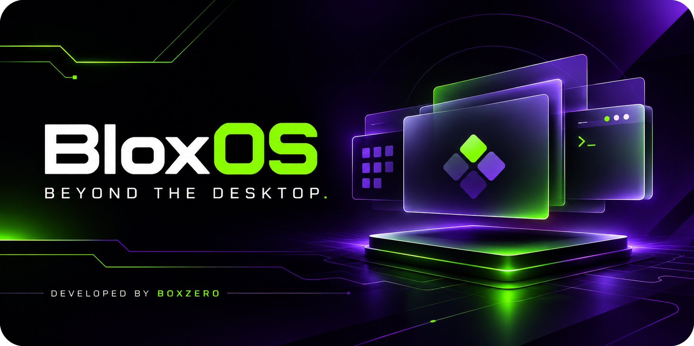

# BloxOS
<p align="center">
  <strong>BloxOS — Beyond the Desktop.</strong>
  <br />
  A new vision for the next generation of operating systems.
</p>

<p align="center">
  
</p>

<p align="center">
  
  
  
  
</p>

---

## About BloxOS

**BloxOS** is an operating system developed by **BoxZero**, with the ambition of creating a modern, independent, and extensible computing platform.

Built around a dedicated system architecture and a modern graphical environment, BloxOS aims to combine system-level engineering, performance, usability, and customization into a unified operating system experience.

Unlike a standalone desktop application, BloxOS is being developed as a complete operating system project, covering multiple layers of computing — from its kernel and boot infrastructure to system services, graphical components, and applications.

Development is focused on establishing a reliable foundation that can evolve into a complete and capable computing platform.

## Core Vision

BloxOS is guided by six fundamental principles:

- **Modern Architecture** — A modular and structured foundation designed for long-term development.
- **Performance** — Efficient system components and optimized resource utilization.
- **User Experience** — A consistent, intuitive, and visually refined desktop environment.
- **Customization** — Flexible configuration of the desktop and system environment.
- **Extensibility** — A foundation for applications, services, tools, and future integrations.
- **Independence** — Developing a distinctive operating system ecosystem under the BoxZero brand.

## Features & Components

BloxOS is being developed across several interconnected system layers. The following sections describe its current development direction and planned capabilities.

### 1. System Architecture

The system architecture provides the foundation for the operating system.

Key development areas include:

- Dedicated BloxOS kernel development.
- Modular organization of system components.
- Separation of core system functionality and user applications.
- Low-level system operations.
- Boot infrastructure and system initialization.
- Foundations for hardware and platform integration.

### 2. Graphical Environment

BloxOS aims to provide a modern desktop experience with a consistent visual identity.

Planned graphical components include:

- Modern desktop environment.
- Qt Quick and QML-based graphical components.
- Desktop navigation and application launcher.
- Start Menu.
- Taskbar and desktop panels.
- Window management and application interfaces.
- Lock Screen.
- System notifications.
- Light and dark themes.
- Responsive desktop layouts.

### 3. System Applications

The BloxOS application ecosystem is designed to include integrated tools for everyday system operations.

| Application | Purpose |
|---|---|
| File Manager | Browse, organize, and manage files and directories. |
| Terminal | Access command-line tools and system commands. |
| Settings | Configure system and desktop preferences. |
| Start Menu | Discover and launch installed applications. |
| System Installer | Install and configure BloxOS. |
| Lock Screen | Provide a dedicated session entry interface. |

Additional built-in applications and utilities may be introduced as development progresses.

### 4. File System & Application Environment

BloxOS is designed around an organized system and application structure.

The planned application directory organization includes:

```text
BloxOS/
│
├── Program Files/
│   └── 64-bit applications
│
├── Program Files (x86)/
│   └── 32-bit applications
│
└── Users/
    └── User accounts and personal files
```

The application environment aims to support:

- Separate locations for 64-bit and 32-bit applications.
- Organized user directories.
- System and user application separation.
- Application management.
- Package management infrastructure.
- Future application installation and update workflows.

### 5. Package Management

A dedicated package management infrastructure is part of the BloxOS development direction.

Its intended responsibilities include:

- Managing application packages.
- Organizing installed software.
- Supporting application installation and removal.
- Managing package information and dependencies.
- Providing a foundation for future software distribution.

The package management system will evolve alongside the application ecosystem.

### 6. Language & Localization

BloxOS is designed with multilingual support and localization in mind.

**BXZ-LANG**, a language project from the BoxZero ecosystem, is being integrated into the BloxOS installation experience.

During installation, users will be able to choose whether to install BXZ-LANG or continue the setup without it.

The broader localization direction includes:

- Multilingual interface support.
- Language configuration.
- Improved localization infrastructure.
- Integration with BoxZero language technologies.

---

## Technology Stack

BloxOS combines several technologies, each selected for specific system development responsibilities.

| Technology | Primary Purpose |
|---|---|
| Rust | Kernel and low-level system development |
| C | System-level functionality |
| C++ | Native components and system integrations |
| Assembly | Architecture-specific low-level operations |
| Qt 6 | Graphical application and interface framework |
| Qt Quick / QML | Modern graphical user interfaces |
| CMake | Build system configuration |
| Ninja | Build execution |
| NASM | Assembly development |
| GRUB / UEFI | Boot infrastructure, depending on target configuration |
| QEMU | Virtual machine testing and development |

The exact toolchain and technology requirements may vary depending on the component and target architecture.

## System Architecture

BloxOS follows a modular architecture intended to separate system responsibilities and support maintainable development.

The project is organized around the following major components:

```text
BloxOS/
│
├── kernel/
│   └── Core kernel implementation
│
├── base/
│   └── Essential base system components
│
├── cli/
│   └── Command-line infrastructure
│
├── package-manager/
│   └── Package management system
│
├── shell/
│   └── System shell
│
├── system-services/
│   └── Background system services
│
├── installer/
│   └── Operating system installation
│
├── gui/
│   └── Graphical environment
│
├── apps/
│   └── System applications
│
├── assets/
│   └── Icons, images, and visual resources
│
├── docs/
│   └── Technical documentation
│
├── CMakeLists.txt
└── README.md
```

**Note:** This diagram illustrates the intended high-level project organization. The actual source tree and component boundaries may evolve during development.

## Installation & Boot Experience

The BloxOS installer is being designed to provide a structured and straightforward operating system setup process.

The planned installation workflow includes:

1. Starting the installation environment.
2. Selecting installation preferences.
3. Configuring the installation.
4. Choosing whether to install BXZ-LANG.
5. Installing the operating system components.
6. Completing the initial system configuration.
7. Preparing the system for its first boot.

The final installation workflow and available configuration options will depend on the implementation of each component.

### Boot Infrastructure

BloxOS development also includes its boot environment and system initialization process.

Development areas include:

- Bootloader integration.
- GRUB and UEFI boot configurations, depending on the target.
- Kernel loading.
- Initial system startup.
- Integration between the boot process and the operating system components.

## Development Environment

BloxOS development currently targets a Linux-based development toolchain. Windows development is also supported through compatible environments such as WSL.

### Recommended Development Tools

- Linux or Windows with WSL.
- Qt 6.
- CMake.
- Ninja.
- Rust toolchain.
- GCC / G++.
- NASM.
- QEMU.
- GRUB and UEFI development tools, where required.

The required tools may differ depending on the component being built.

## Building from Source

The following commands provide a general example of configuring and building the project.

### 1. Clone the Repository

```bash
git clone <YOUR-REPOSITORY-URL>
cd BloxOS
```

### 2. Configure the Build

```bash
cmake -S . -B build -G Ninja -DCMAKE_BUILD_TYPE=Debug
```

### 3. Build the Project

```bash
cmake --build build
```

### 4. Run the Desktop Target

If the desktop executable is available in the current build configuration:

```bash
./build/bloxos
```

Actual executable paths and target names may differ between configurations.

### Running BloxOS in QEMU

For an ISO image generated by the project, a basic QEMU launch example is:

```bash
qemu-system-x86_64 \
  -cdrom build/bloxos.iso \
  -m 512M \
  -smp 2
```

For UEFI-based testing, use a compatible OVMF firmware image and the appropriate boot configuration.

**Important:** These commands are examples. The actual output paths, build targets, firmware requirements, and runtime options depend on the current source tree and build configuration.

## Development Roadmap

BloxOS development is organized into several major areas.

| Component | Development Focus |
|---|---|
| Kernel | Core architecture and system foundations |
| Base System | Essential operating system functionality |
| Boot Infrastructure | Bootloader integration and system initialization |
| GUI | Desktop environment and graphical interface |
| System Services | Background system operations |
| Installer | Installation and system configuration |
| Package Manager | Application and package infrastructure |
| File Manager | File browsing and management |
| System Applications | Integrated desktop utilities |
| Localization | Language and regional support |
| Documentation | Technical and user documentation |

### Planned Improvements

Future development goals include:

- Expanded hardware compatibility.
- A more complete desktop environment.
- Improved window and application management.
- Advanced system configuration.
- Expanded package management capabilities.
- Improved localization support.
- Enhanced security and stability.
- Additional developer tools.
- Further system performance optimizations.

*Roadmap items represent development goals and are not necessarily available in the current build.*

## Development Status

**Current Status: In Development**

BloxOS is actively being developed by BoxZero.

Its kernel, system architecture, graphical environment, installation infrastructure, and other components are evolving through ongoing development and testing.

The current development builds are intended for development and testing purposes.

**BloxOS is not yet a final production release.**

### Target Release

**BloxOS 27H1 Horizon**

Target release: **March 2027**

The release schedule and feature availability may change as development progresses.

## Contributing

We welcome feedback, suggestions, bug reports, and contributions from the developer community.

There are several ways to contribute to BloxOS:

1. **Report Bugs** — Submit clear bug reports through GitHub Issues.
2. **Suggest Features** — Share ideas that could improve BloxOS.
3. **Improve Documentation** — Help make technical documentation clearer and more complete.
4. **Review Code** — Identify potential improvements and issues.
5. **Submit Pull Requests** — Propose code changes and improvements.

Before contributing, please make sure your changes are consistent with the project's architecture and development direction.

## About BoxZero

**BloxOS** is developed by **BoxZero**, an independent technology and software development initiative focused on building software, tools, and digital experiences.

BoxZero aims to create innovative projects through engineering, creativity, and continuous development.

### Official Links

- 🌐 Website: https://www.boxzero.ir
- 📢 Telegram: https://t.me/BoxZero_company
- 💬 Support: @boxzerosupport
- ✉️ Email: boxzero.company@gmail.com

## License

The project license will be specified in the repository.

Until a license is officially added, no permission to redistribute, modify, or reuse the source code should be assumed.

Please check the repository for the latest licensing information.

---

<p align="center">
  <strong>BloxOS</strong>
  <br />
  Beyond the Desktop.
  <br /><br />
  <strong>Developed by BoxZero</strong>
  <br />
  Building Beyond Limits.
  <br /><br />
  © 2026 BoxZero. All rights reserved.
</p>
